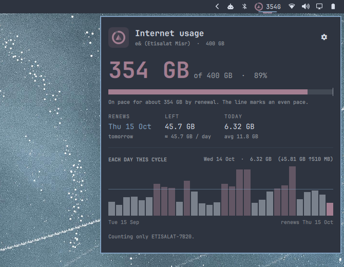
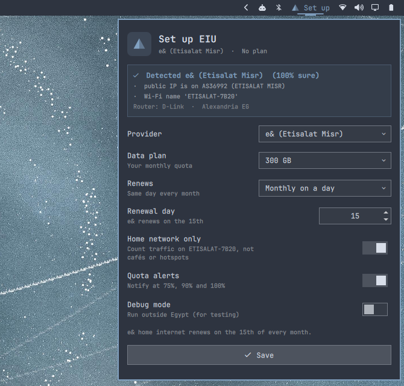

<p align="center"></p>

<p align="center">
  How much of your home internet quota this computer has used, day by day,<br>
  and when it renews. A bar widget for <a href="https://omarchy.org">Omarchy</a>, made for Egypt.
</p>

<p align="center"></p>

Home internet in Egypt comes with a monthly quota, and when it runs out the
line drops to a crawl. EIU sits on your bar as a small ring that fills as you
use data, tells you what's left and when it renews, and warns you before
you hit the wall.

<p align="center"></p>

## What it does

- **A quota ring on the bar.** The ring fills with your usage and turns from your
  theme's accent colour toward its warning colour at 75% and 90%. The text next
  to it shows data used, data left, a percentage, or nothing. Right-click to cycle.
- **A bar for every day of the cycle**, from the last renewal to the next.
  Hover a day for its download and upload. Days over your even daily share are
  tinted, and a line marks that share.
- **The renewal date and countdown**, plus what you can still spend per day
  to make it.
- **Pace and projection.** A marker on the progress bar shows where you'd be at
  an even pace, and EIU tells you if this pace runs out before renewal.
- **Alerts** at 75%, 90% and 100%, as Omarchy notifications.
- **Only your home network counts.** Café Wi-Fi or a phone hotspot doesn't eat
  into your home quota, so by default EIU counts only the network you set it up
  on. You can switch to counting everything.
- **Follows your theme.** Every colour comes from the active Omarchy theme and
  updates live when you switch.

## Provider auto-detection

When you open setup, EIU reads what the machine can see and scores each provider:

| Signal | Example | Weight |
| --- | --- | --- |
| The network (ASN) your public IP belongs to | `AS36992 ETISALAT MISR` | strongest |
| The Wi-Fi name the router ships with | `ETISALAT-7B20`, `WE_xxxx`, `Orange-xxxx` | strong |
| Reverse DNS of your public IP | `*.tedata.net` | supporting |
| The router's own web page title | `D-Link`, `HG8145V5` | supporting |

It knows **e& (Etisalat Misr)**, **WE (Telecom Egypt / TE Data)**, **Orange**,
**Vodafone** and **Noor**. You can always override the guess. `eiu detect`
shows the evidence.

## When does my quota renew?

There's no single answer in Egypt, so EIU supports both schemes:

| Provider | How it renews | EIU default |
| --- | --- | --- |
| e& | Monthly on a fixed day | the 15th |
| WE | 30 days after your last renewal. Renewing early resets the cycle to that day | every 30 days from a date you give |
| Orange, Vodafone, Noor | Monthly on your account's date (shown in their apps) | the day you set |

## Setup

<p align="center"></p>

Click the pyramid on the bar. EIU fills in the provider it detected, and you
pick the plan from one dropdown (200 GB, 300 GB … 1 TB, or a custom size). The
renewal day comes from your provider. That's it.

From a terminal, `eiu setup` asks the same questions.

## Install

```bash
omarchy plugin add https://github.com/Malekabokhatwa/EIU.git --enable --yes
```

To use the CLI too:

```bash
ln -sf ~/.config/omarchy/plugins/eiu/bin/eiu ~/.local/bin/eiu
```

To hack on it, clone it anywhere and run `./install.sh`, which links the
checkout in as the plugin.

Requirements: Omarchy with the Quickshell bar, `python3`, `iproute2`, `iw` and
`curl`, all of which ship with Omarchy. `gum` is used by `eiu setup`.

## Only in Egypt

EIU is for Egyptian home plans, so it shows up only when you're in Egypt. It
checks your public IP's country every few hours. Your home network and the
`Africa/Cairo` timezone count as Egypt when you're offline or on a VPN. Abroad
the widget hides itself and traffic isn't counted.

**Debug mode** lifts that restriction for testing: `eiu debug on`, or the switch
in setup. A `DEBUG` badge shows while it's on.

## The CLI

```text
eiu                     status for the current cycle, with a per-day chart
eiu setup               interactive setup
eiu set plan 600        change one setting (eiu set --help for all)
eiu detect              how the provider was recognised
eiu adjust 212GB        match this cycle to your provider's figure
eiu history             totals of past cycles
eiu debug on|off        run outside Egypt
eiu doctor              check the install
```

`omarchy-shell eiu toggle|refresh|setup|status` controls the widget over IPC,
which makes it easy to bind to a key.

Bar options (`omarchy bar set eiu <key> <value>`): `display` is `used`,
`remaining`, `percent` or `icon`; `showRing` is `true` or `false`;
`refreshSeconds` defaults to `60`.

## How it counts

Every minute, EIU reads the byte counters of your physical network interfaces
from `/proc/net/dev` and adds what moved since the last reading to that day's
total for the network you're on. It skips loopback, Docker, VPN and Tailscale
interfaces, because their traffic already crosses the physical link. Reboots
and counter resets are handled.

- Data: `~/.local/share/eiu/ledger.json`, about a year of days
- Settings: `~/.config/eiu/config.json`

**Limits.** EIU measures this computer, not your whole household: phones and
TVs on the same router use the quota too. If you install EIU partway through a
cycle, run `eiu adjust <amount>` with the figure from your provider's app so
the total is right from day one.

## License

MIT
